# 🛡️ GuardUp – System Analysis & Technical Architecture

## 1. Executive Summary

**GuardUp** is an on-demand personal security and bodyguard booking platform engineered for iOS, Android, and Web. The platform establishes a trusted marketplace connecting licensed, verified bodyguards with individual and corporate clients.

The platform consists of three core applications:
1. **Bodyguard Mobile App** (iOS & Android – Flutter): Provider interface for onboarding, scheduling, job management, active assignment execution, and financial tracking.
2. **Customer Mobile App** (iOS & Android – Flutter): Client interface for bodyguard discovery, filtering, scheduling, in-app payments, membership plans, and active tracking with family sharing.
3. **Super Admin Web Panel** (Web Console): Back-office control plane for KYC document review, bodyguard approval/blocking, booking audit trails, commission/pricing configuration, and manual payout processing.

---

## 2. High-Level System Architecture

```mermaid
flowchart TD
    subgraph ClientLayer["Mobile & Web Clients"]
        CustomerApp["Customer App (Flutter)"]
        GuardApp["Bodyguard App (Flutter)"]
        AdminPanel["Super Admin Web Panel"]
        FamilyWeb["Family Tracking Web/App View"]
    end

    subgraph ServiceLayer["Core Platform Services"]
        AuthService["Auth & RBAC Service"]
        BookingEngine["Booking & Matching Engine"]
        LocationHub["Real-time GPS Tracking Hub"]
        ChatHub["Encrypted In-App Chat"]
        WalletService["Wallet & Payout Service"]
        KYCService["Document & KYC Review Desk"]
    end

    subgraph ExternalIntegrations["Third-Party Services"]
        StripeGateway["Stripe Payments & Subscriptions"]
        MapProvider["Map & Geo Service (Google Maps / Mapbox)"]
        NotificationGateway["Push Notifications (FCM / APNs)"]
        BankTransfer["Manual Banking / Wire Transfer"]
        CloudStorage["Secure Encrypted Storage (KYC/IDs)"]
    end

    CustomerApp -->|Bookings & Payments| BookingEngine
    CustomerApp -->|Search & Map Filter| MapProvider
    CustomerApp -->|Purchase Memberships| StripeGateway
    CustomerApp -->|Live Tracking & Chat| LocationHub
    CustomerApp -.->|Location Share Link| FamilyWeb

    GuardApp -->|Registration Fee| StripeGateway
    GuardApp -->|Upload Licenses & ID| CloudStorage
    GuardApp -->|Schedule & Status| BookingEngine
    GuardApp -->|Background GPS Stream| LocationHub
    GuardApp -->|In-app Chat| ChatHub
    GuardApp -->|Payout Requests| WalletService

    AdminPanel -->|Review Documents| KYCService
    AdminPanel -->|Manage Rates & Commission| BookingEngine
    AdminPanel -->|Approve & Wire Transfers| BankTransfer
    AdminPanel -->|Audit Logs & Chats| ChatHub

    LocationHub --> CustomerApp
    LocationHub --> FamilyWeb
```



---

## 3. Detailed Functional Modules

### A. Bodyguard App (Provider Interface)
* **Registration & Multi-Step KYC Onboarding:**
  * Profile creation with professional bio, past experience, security specializations, and clear profile photos.
  * Document upload portal: Government ID, background check verification certificates, security licenses, first aid certifications, and firearms permits (where applicable).
  * **Onboarding Paywall:** Mandatory one-time registration fee processed via Stripe before profile submission.
  * Account approval gatekeeper: Profile placed in `Pending Review` status with locked job access until Super Admin approval.
* **Pricing & Schedule Management:**
  * Custom hourly rate setup (within platform min/max guidelines).
  * Interactive calendar for shift availability (toggle on/off dates, hourly time slots).
* **Booking Lifecycle & Operations:**
  * Real-time notifications for incoming booking requests with client details, location, and requested duration.
  * Actions: Accept, Decline, Start Assignment, Complete Assignment.
  * **Active Assignment Console:**
    * In-app encrypted messaging and calling with customer.
    * Persistent foreground service streaming high-precision GPS coordinates.
* **Earnings, Wallet & Bank Payouts:**
  * Live wallet balance displaying net earnings after platform commission.
  * Detailed transaction history per booking (Gross Amount, Commission Deducted, Net Earnings).
  * Bank details management (Account number, routing code, holder name).
  * Payout withdrawal requests with status history (`Pending` ➔ `In Review` ➔ `Completed`).
  * Customer ratings and performance reviews.

---

### B. Customer App (Client Interface)
* **Discovery & Search Engine:**
  * Map view and list view of verified bodyguards in proximity.
  * Multi-attribute filtering: Hourly rate range, minimum customer rating, specific certifications, verified badges, and availability date/time.
  * Rich profile view: Background experience, verified security credentials, and previous client reviews.
* **Booking & Checkout Engine:**
  * Date picker, start time, and total booking duration selection.
  * Price calculation with real-time tax and commission preview.
  * **Membership Program:**
    * Tiered subscription plans (e.g., Bronze, Silver, Gold).
    * Automated discount application (e.g., 10%, 20%, 30% off eligible booking totals).
  * Stripe checkout: Support for credit/debit cards, Apple Pay, and Google Pay.
* **Safety, Tracking & Family Sharing:**
  * Real-time map displaying the bodyguard's live location approaching and during the assignment.
  * In-app secure chat with the assigned bodyguard.
  * **Family Access Control:** Generate a secure, time-expiring web tracking link or grant direct access to designated family contacts to monitor the assignment in real-time.
* **Post-Booking Experience:**
  * Complete booking history and downloadable receipts.
  * 5-star rating system with written feedback and review submission.

---

### C. Super Admin Web Panel (Governance & Operations)
* **KYC & Document Review Desk:**
  * Centralized queue of newly registered bodyguard profiles.
  * In-browser high-resolution document viewer for identity proofs, licenses, and background checks.
  * Actions: Approve, Request Resubmission, Reject, or Block/Unblock accounts.
* **Platform Monetization & Economics Configuration:**
  * Global platform commission percentage management (e.g., 20% default).
  * Membership tiers management: pricing, discount rates (10%, 20%, 30%), and validity periods.
  * Hourly rate floor and ceiling limits.
* **Operations & Safety Audit:**
  * Overview of all active, upcoming, completed, and cancelled bookings.
  * Complete audit trail: access to booking-related chat transcripts and tracking history for dispute resolution.
  * Review and rating moderation desk.
* **Financial Operations & Manual Payouts:**
  * Bodyguard wallet balance overview.
  * Payout request queue with bodyguard banking details.
  * Manual bank wire processing verification: admin initiates wire and updates status from `Pending` to `Completed`.
* **Platform Health & Reporting:**
  * Revenue breakdown (Membership fees, Registration fees, Commission cuts).
  * Push notification broadcast center for announcements.

---

## 4. Financial & Commission Lifecycle

### Flow of Funds Diagram
```
Customer Booking ($100/hr × 2 hrs = $200)
    │
    ├── Apply 20% Membership Discount (e.g., -$40)
    │
    ▼
Total Paid by Customer via Stripe: $160.00
    │
    ├── Platform Commission (20% of $160) = $32.00  ──► Platform Revenue
    │
    ▼
Net Bodyguard Allocation (80% of $160) = $128.00 ──► Credited to Guard Wallet
    │
    ▼
Guard Requests Payout ($128.00) ──► Admin Transferred Manually ──► Status: Completed
```

### Financial Summary Table

| Transaction Type | Trigger | Payer | Payee | Mechanism |
| :--- | :--- | :--- | :--- | :--- |
| **Registration Fee** | One-time guard onboarding | Bodyguard | Platform | Stripe Payment Sheet / Checkout |
| **Membership Purchase** | Recurring / one-time subscription | Customer | Platform | Stripe Subscriptions / Payment |
| **Booking Payment** | Job scheduling | Customer | Platform Escrow | Stripe PaymentIntent |
| **Commission Split** | Job completed & settled | Booking Escrow | Platform (20%) + Guard (80%) | Internal Wallet Ledger |
| **Withdrawal / Payout** | Guard payout request | Platform Account | Bodyguard Bank Account | Manual Wire / ACH Transfer |

---

## 5. Technical Requirements & Implementation Strategy

### 1. Mobile Development (Flutter)
* **Target Platforms:** iOS & Android.
* **Codebase Structure:** Single unified Flutter codebase utilizing role-based access / flavors (`Customer` mode vs `Bodyguard` mode) to maximize reuse of UI components, models, and network layers.
* **Key Packages & Capabilities:**
  * **State Management:** BLoC / Riverpod for predictable, testable state handling.
  * **Location Services:** `geolocator` & `flutter_background_geolocation` with Android Foreground Services (`FOREGROUND_SERVICE_LOCATION`) and iOS `UIBackgroundModes = location`.
  * **Mapping:** `google_maps_flutter` or `mapbox_maps_flutter` with custom marker rendering and polyline route tracking.
  * **Payments:** `flutter_stripe` supporting PaymentSheet, Apple Pay, and Google Pay.
  * **Realtime Communication:** WebSockets / Firebase Firestore for sub-second chat delivery and live coordinate streaming.
  * **Push Notifications:** Firebase Cloud Messaging (`firebase_messaging`) for background job alerts, chat messages, and payout status updates.

### 2. Family Sharing Architecture
* To make family tracking accessible without forcing family members to create full accounts:
  * Generate a cryptographically signed, short-lived tokenized URL (e.g., `https://track.guardup.com/live/{session_token}`).
  * Responsive web view renders live map markers, bodyguard contact card, and emergency hotline button.

---

## 6. Business Policies & Pending Clarifications

Before full-scale backend development, the following business policies should be confirmed:
1. **Cancellation & Refund Policy:**
   * Window for free cancellation (e.g., > 24 hours).
   * Late cancellation fee (e.g., within 2 hours of shift, customer pays 1 hour base rate to compensate the bodyguard).
2. **Membership Renewal & Validity:**
   * Duration of validity (e.g., Monthly auto-renewing vs. Annual vs. Fixed credits).
   * Limitations on discount usage per billing cycle.
3. **Background Verification Automation:**
   * Phase 1: Purely manual document upload & admin verification desk.
   * Phase 2 (Optional): Integration with automated KYC identity verification APIs (e.g., Stripe Identity, Persona, or Checkr).

